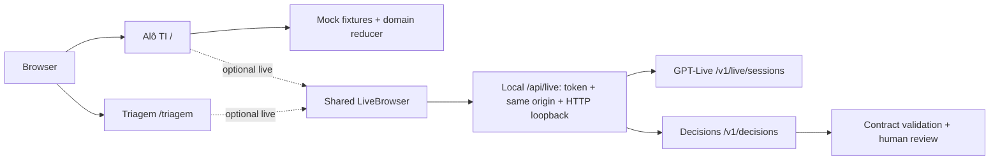
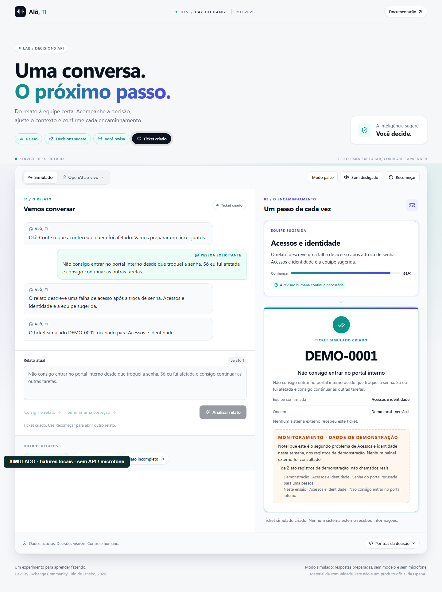
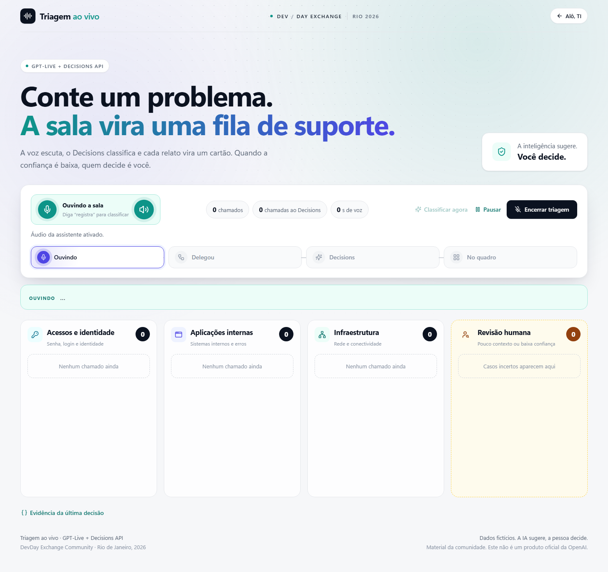

# Decisions AI Demos — Alô, TI + Triagem

[](https://github.com/glaucia86/decisions-ai-demos/actions/workflows/ci.yml)   [](LICENSE)

[Português](README.md) · [English](README.en.md) · [Español](README.es.md)

Two learning experiences for structured decisions, voice and human review, created by **Glaucia Lemos** for DevDay Exchange Community Rio 2026. This independent repository continues their development. The UI is in Portuguese. This is a local demo, without a production or SaaS readiness claim.

## Contents

- [Experiences](#experiences)
- [Run the simulated mode](#run-the-simulated-mode)
- [Architecture](#architecture)
- [Optional live mode and safety](#optional-live-mode-and-safety)
- [Tests and evidence](#tests-and-evidence)
- [Origin and license](#origin-and-license)

## Experiences

| Application | Route | Experience |
| --- | --- | --- |
| **Alô, TI** | `/` | Fictional service desk: report, analysis, correction, review and simulated ticket. Fixtures by default, no API calls. |
| **Triagem ao vivo** | `/triagem` | Team board and human review, with a queue and local restoration. Voice requires explicit activation; browser tests simulate transport. |

## Run the simulated mode

Use Node.js **24.12.0–24.21.0** (`.nvmrc`: 24.21.0; `engine-strict` enabled). Dependencies are pinned in the lockfile. Installation needs internet; the mock then works without an account, key or microphone. Use `npm.cmd` in PowerShell. Run commands from this repository root.

```sh
git clone https://github.com/glaucia86/decisions-ai-demos.git
cd decisions-ai-demos
npm ci --ignore-scripts
npm run typecheck
npm test
npm run build
npm start
```

Open http://127.0.0.1:3000/ and choose **Explorar cenário**. The board is at http://127.0.0.1:3000/triagem. Busy port: `npm start -- -p 3002`. For editing, use `npm run dev`. [Guided practice, Portuguese](docs/primeiros-passos.md).

## Architecture

GPT-Live handles the spoken conversation; the Decisions API evaluates structured questions. In Triagem, client delegation routes a report through the application to Decisions using `gpt-6-luna`: `predicate` checks context, `choice` selects a team and `score` evaluates impact. Uncertain cases require human review. Alô, TI’s simulated mode uses fixtures and optional device speech. Its separate live tab uses Responses delegation and the same reducer as the buttons. This code does not use the native Decisions integration shown in the current guide.



[GPT-Live](https://developers.openai.com/api/docs/guides/live) · [Decisions](https://developers.openai.com/api/docs/guides/decisions) · [Voice + Decisions](https://developers.openai.com/api/docs/guides/decisions-voice) · [Client delegation](https://developers.openai.com/api/docs/guides/live-delegation?delegation-mode=client)

## Optional live mode and safety

Live is off by default (`MESA_LIVE_ENABLED=false`). Opening a tab does not start a session or request a microphone. Verify model access, current documentation and account costs before enabling it. Follow the [local guide, Portuguese](docs/integracao-live.md): copy `.env.example` to `.env.local` without overwriting existing settings; keep the key server-side and use a separate local token. Never put secrets in chat, screenshots, Git or a `NEXT_PUBLIC` variable.

Guards require **HTTP loopback, matching origin and local token**. Do not expose this server through a tunnel, proxy or public hosting. In-memory limits are not a financial cap. Resuming opens a new session; muting does not close it. Fictional board/queue reports may persist in localStorage. Confirm remote closure before leaving the page.

## Tests and evidence

Real browser captures use fictional data; they do not establish real voice or inference results. The [validation record, Portuguese](docs/validacao.md) separates local checks and CI. Linux may need `npx playwright install --with-deps chromium`. CI runs unit tests, types, build, local-origin protection and browser fixtures without a paid key.

```sh
node --test tests/*.test.mts
node scripts/replay-voice-commands.mts
node scripts/check-doc-links.mjs
npm run typecheck
npm run build
node --test tests/live-origin.mjs
npx playwright install chromium
# terminal 1
npm start
# terminal 2
node tests/browser.mjs
npm run test:triage-browser
```



**Triagem: SIMULADO / browser test fixture — sem sessão real / no real session / sin sesión real.**



[Vídeo / Video — SIMULADO](docs/media/mock-demo.webm)

[Adapted HTML presenter scripts: Alô, TI and Triagem](docs/demo-scripts/index.html) — Portuguese speaking notes, stage mode, copy buttons and checklist; [originals and changes](docs/demo-scripts/README.md). Download the repository and open the HTML locally; GitHub displays source code.

## Origin and license

Fully extracted from `apps/decisions` in the [event repository](https://github.com/glaucia86/devday-exchange-community-rio-2026/tree/ab074cc44ec36cd20ce4d6b593a4cd152e41b5f7/apps/decisions), preserving **42 filtered commits**. [Provenance, source commit and original scripts](docs/proveniencia.md). [MIT](LICENSE) — Copyright (c) 2026 Glaucia Lemos. Historical event materials remain available.
