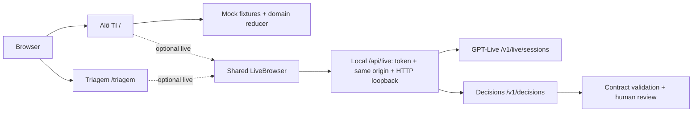
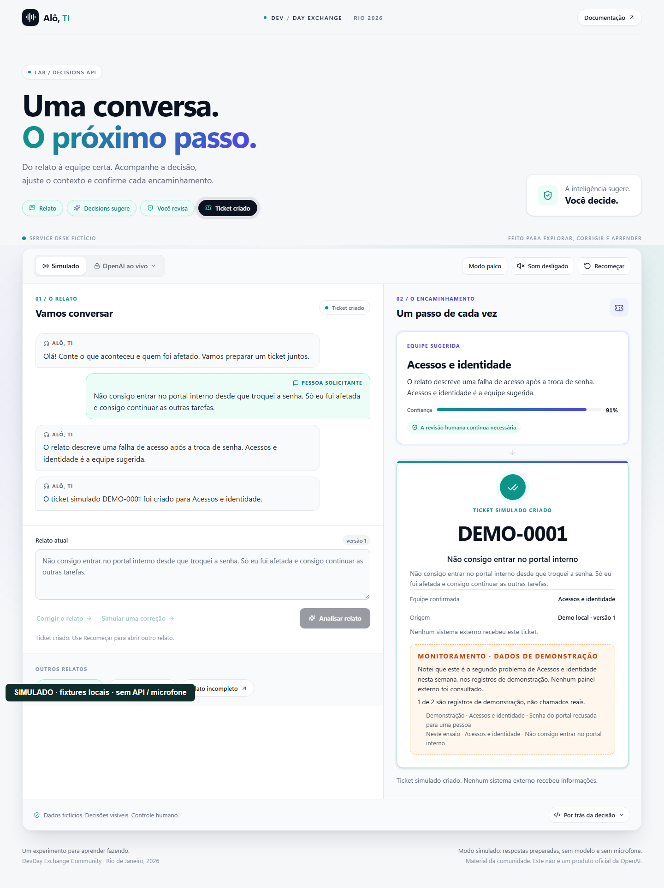
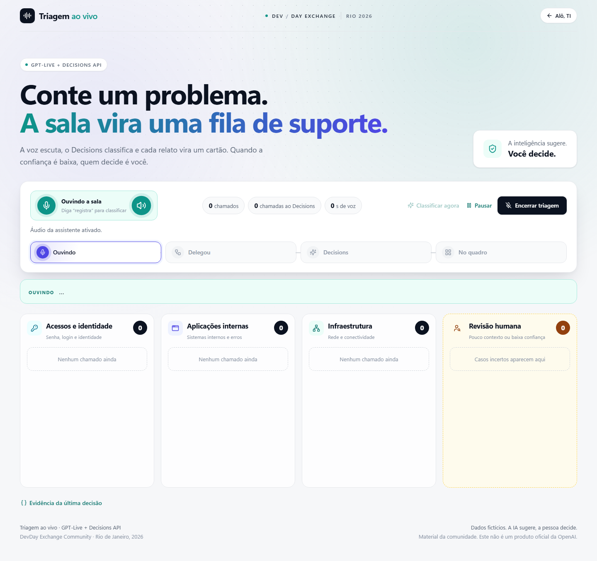

# Decisions AI Demos — Alô, TI + Triagem

[](https://github.com/glaucia86/decisions-ai-demos/actions/workflows/ci.yml)   [](LICENSE)

[Português](README.md) · [English](README.en.md) · [Español](README.es.md)

Dos experiencias de aprendizaje sobre decisiones estructuradas, voz y revisión humana, creadas por **Glaucia Lemos** para DevDay Exchange Community Rio 2026. Este repositorio independiente continúa su evolución. La interfaz está en portugués. Es una demo local, sin afirmar preparación para SaaS o producción.

## Índice

- [Experiencias](#experiencias)
- [Ejecutar el modo simulado](#ejecutar-el-modo-simulado)
- [Arquitectura](#arquitectura)
- [Live opcional y seguridad](#live-opcional-y-seguridad)
- [Pruebas y evidencias](#pruebas-y-evidencias)
- [Origen y licencia](#origen-y-licencia)

## Experiencias

| Aplicación | Ruta | Experiencia |
| --- | --- | --- |
| **Alô, TI** | `/` | Mesa de ayuda ficticia: relato, análisis, corrección, revisión y ticket simulado. Datos preparados por defecto, sin API. |
| **Triagem ao vivo** | `/triagem` | Tablero por equipos y revisión humana, con cola y restauración local. La voz requiere activación explícita; las pruebas simulan el transporte. |

## Ejecutar el modo simulado

Usa Node.js **24.12.0–24.21.0** (`.nvmrc`: 24.21.0; `engine-strict` activo). Dependencias fijadas en el lockfile. La instalación necesita internet; después el mock funciona sin cuenta, clave ni micrófono. En PowerShell usa `npm.cmd`. Ejecuta los comandos desde la raíz del repositorio.

```sh
git clone https://github.com/glaucia86/decisions-ai-demos.git
cd decisions-ai-demos
npm ci --ignore-scripts
npm run typecheck
npm test
npm run build
npm start
```

Abre http://127.0.0.1:3000/ y selecciona **Explorar cenário**. El tablero está en http://127.0.0.1:3000/triagem. Puerto ocupado: `npm start -- -p 3002`. Para editar usa `npm run dev`. [Práctica guiada en portugués](docs/primeiros-passos.md).

## Arquitectura

GPT-Live gestiona la conversación por voz; la API Decisions evalúa preguntas estructuradas. En Triagem, la delegación al cliente envía el relato por la aplicación a Decisions con `gpt-6-luna`: `predicate` evalúa contexto, `choice` selecciona un equipo y `score` evalúa impacto. Los casos inciertos requieren revisión humana. El modo simulado de Alô, TI usa datos preparados y voz opcional del dispositivo. Su pestaña live utiliza delegación Responses y el mismo reductor de los botones. Este código no usa la integración nativa Decisions del documento actual.



[GPT-Live](https://developers.openai.com/api/docs/guides/live) · [Decisions](https://developers.openai.com/api/docs/guides/decisions) · [Voice + Decisions](https://developers.openai.com/api/docs/guides/decisions-voice) · [Client delegation](https://developers.openai.com/api/docs/guides/live-delegation?delegation-mode=client)

## Live opcional y seguridad

Live está desactivado por defecto (`MESA_LIVE_ENABLED=false`). Abrir una pestaña no inicia sesión ni solicita micrófono. Verifica acceso a modelos, documentación actual y costes antes de activarlo. Sigue la [guía local en portugués](docs/integracao-live.md): copia `.env.example` a `.env.local` sin sobrescribir ajustes existentes; guarda la clave solo en el servidor y usa un token local distinto. Nunca envíes secretos por chat, capturas, Git ni variables `NEXT_PUBLIC`.

Las protecciones exigen **HTTP loopback, mismo origen y token local**. No expongas el servidor mediante túnel, proxy o alojamiento público. Los límites en memoria no son un límite financiero. Reanudar abre otra sesión; silenciar no la cierra. Los relatos ficticios del tablero y la cola pueden persistir en localStorage. Confirma el cierre remoto antes de salir.

## Pruebas y evidencias

Capturas reales del navegador con datos ficticios; no demuestran voz ni inferencia reales. El [registro de validación en portugués](docs/validacao.md) distingue comprobaciones locales y CI. En Linux puede ser necesario `npx playwright install --with-deps chromium`. CI ejecuta pruebas, tipos, build, origen local y fixtures de navegador sin clave de pago.

```sh
node --test tests/*.test.mts
node scripts/replay-voice-commands.mts
node scripts/check-doc-links.mjs
npm run typecheck
npm run build
node --test tests/live-origin.mjs
npx playwright install chromium
# terminal 1
npm start
# terminal 2
node tests/browser.mjs
npm run test:triage-browser
```



**Triagem: SIMULADO / browser test fixture — sem sessão real / no real session / sin sesión real.**



[Vídeo / Video — SIMULADO](docs/media/mock-demo.webm)

## Origen y licencia

Extraído íntegramente de `apps/decisions` del [repositorio del evento](https://github.com/glaucia86/devday-exchange-community-rio-2026/tree/ab074cc44ec36cd20ce4d6b593a4cd152e41b5f7/apps/decisions), conservando **42 commits filtrados**. [Procedencia, commit y guiones originales](docs/proveniencia.md). [MIT](LICENSE) — Copyright (c) 2026 Glaucia Lemos. Se conservan los materiales históricos del evento.
