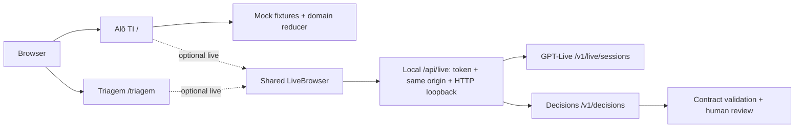

# Decisions AI Demos — Alô, TI + Triagem

[](https://github.com/glaucia86/decisions-ai-demos/actions/workflows/ci.yml)   [](LICENSE)

[Português](README.md) · [English](README.en.md) · [Español](README.es.md)

Duas experiências de estudo sobre decisões estruturadas, voz e revisão humana, criadas por **Glaucia Lemos** para o DevDay Exchange Community Rio 2026. Este é o repositório independente para sua evolução. Interface em português; aplicação local de demonstração, sem prontidão declarada para SaaS ou produção.

## Sumário

- [Experiências](#experiências)
- [Começar no modo simulado](#começar-no-modo-simulado)
- [Arquitetura](#arquitetura)
- [Live opcional e segurança](#live-opcional-e-segurança)
- [Testes e evidências](#testes-e-evidências)
- [Origem e licença](#origem-e-licença)

## Experiências

| Aplicação | Rota | Experiência |
| --- | --- | --- |
| **Alô, TI** | `/` | Service desk fictício: relato, análise, correção, revisão e ticket simulado. Fixtures por padrão; nenhuma API. |
| **Triagem ao vivo** | `/triagem` | Quadro de equipes e revisão humana, com fila e restauração local. Voz exige ativação explícita; testes de navegador simulam o transporte. |

## Começar no modo simulado

Use Node.js **24.12.0 a 24.21.0** (`.nvmrc`: 24.21.0; `engine-strict` ativo). Dependências fixadas no lockfile. A instalação precisa de internet; depois o mock funciona sem conta, chave ou microfone. No PowerShell, use `npm.cmd`. Os comandos partem da raiz deste repositório.

```sh
git clone https://github.com/glaucia86/decisions-ai-demos.git
cd decisions-ai-demos
npm ci --ignore-scripts
npm run typecheck
npm test
npm run build
npm start
```

Abra http://127.0.0.1:3000/ e escolha **Explorar cenário**. A Triagem está em http://127.0.0.1:3000/triagem. Porta ocupada: `npm start -- -p 3002`. Para editar, use `npm run dev`. [Prática guiada](docs/primeiros-passos.md).

## Arquitetura

GPT-Live conduz a conversa por voz; a API Decisions avalia perguntas estruturadas. Na Triagem, a delegação para o cliente encaminha o relato pela aplicação ao Decisions com `gpt-6-luna`: `predicate` avalia contexto, `choice` escolhe a equipe e `score` avalia impacto. Casos incertos exigem revisão humana. O modo Simulado da Alô, TI usa dados preparados e voz opcional do dispositivo. A aba live da Alô, TI usa delegação Responses e o mesmo redutor dos botões. Não é a integração nativa Decisions descrita no guia atual.



[GPT-Live](https://developers.openai.com/api/docs/guides/live) · [Decisions](https://developers.openai.com/api/docs/guides/decisions) · [Voice + Decisions](https://developers.openai.com/api/docs/guides/decisions-voice) · [Client delegation](https://developers.openai.com/api/docs/guides/live-delegation?delegation-mode=client)

## Live opcional e segurança

Live desativado por padrão (`MESA_LIVE_ENABLED=false`). Abrir uma aba não inicia sessão nem pede microfone. Antes de habilitar, confira acesso aos modelos, documentação e custo da conta. Siga o [guia local](docs/integracao-live.md): copie `.env.example` para `.env.local` sem sobrescrever configurações existentes; mantenha a chave apenas no servidor e use um token local distinto. Nunca envie segredos em chat, screenshots ou Git, nem use `NEXT_PUBLIC` para a chave.

As proteções exigem **HTTP loopback, mesma origem e token local**. Não exponha por túnel, proxy ou hospedagem pública. Limites em memória não são teto financeiro. Retomar abre nova sessão; silenciar áudio não encerra sessão. Relatos fictícios do quadro/fila podem ficar no localStorage. Confira encerramento remoto antes de fechar a página.

## Testes e evidências

Capturas reais do navegador com dados fictícios; não comprovam voz ou inferência reais. [Registro de validação](docs/validacao.md) distingue resultados locais e CI. No Linux, Chromium pode precisar de `npx playwright install --with-deps chromium`. A CI executa testes, tipos, build, origem local e fixtures de navegador, sem chave paga.

```sh
node --test tests/*.test.mts
node scripts/replay-voice-commands.mts
node scripts/check-doc-links.mjs
npm run typecheck
npm run build
node --test tests/live-origin.mjs
npx playwright install chromium
# terminal 1
npm start
# terminal 2
node tests/browser.mjs
npm run test:triage-browser
```


**Triagem: SIMULADO / browser test fixture — sem sessão real / no real session / sin sesión real.**


[Vídeo / Video — SIMULADO](docs/media/mock-demo.webm)

[Roteiros HTML adaptados: Alô, TI e Triagem](docs/demo-scripts/index.html) — modo palco, copiar falas e checklist; [originais e diferenças](docs/demo-scripts/README.md). Baixe o repositório e abra o HTML localmente; o GitHub exibe o código-fonte.

## Origem e licença

Extraído integralmente de `apps/decisions` no [repositório do evento](https://github.com/glaucia86/devday-exchange-community-rio-2026/tree/ab074cc44ec36cd20ce4d6b593a4cd152e41b5f7/apps/decisions). Histórico filtrado preservado: **42 commits**. [Proveniência, commit e roteiros originais](docs/proveniencia.md). [MIT](LICENSE) — Copyright (c) 2026 Glaucia Lemos. O material histórico do evento permanece disponível.
