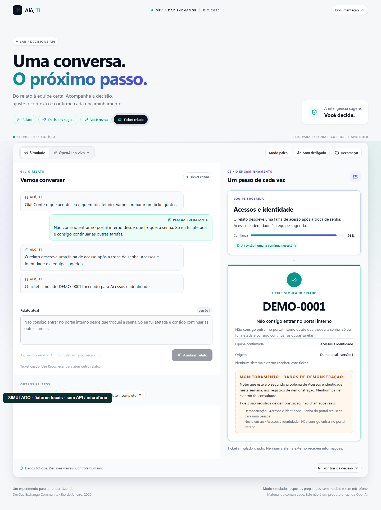
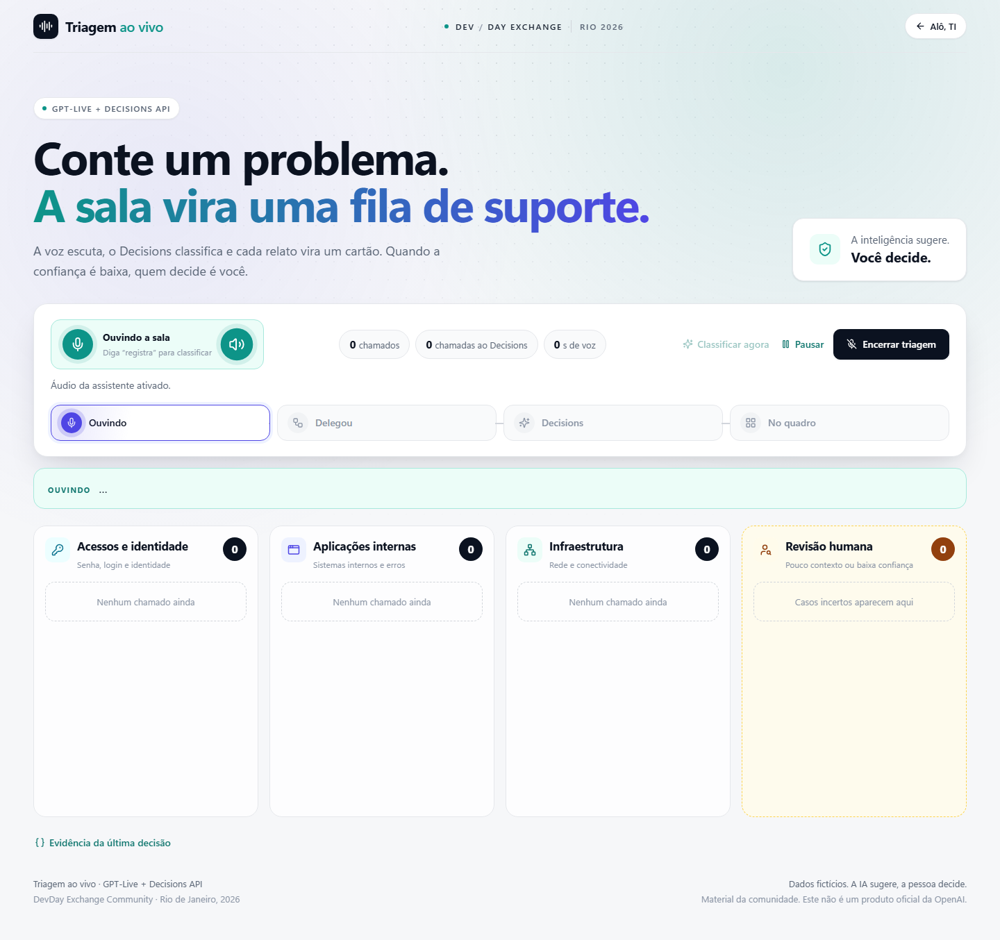
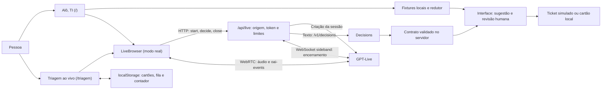
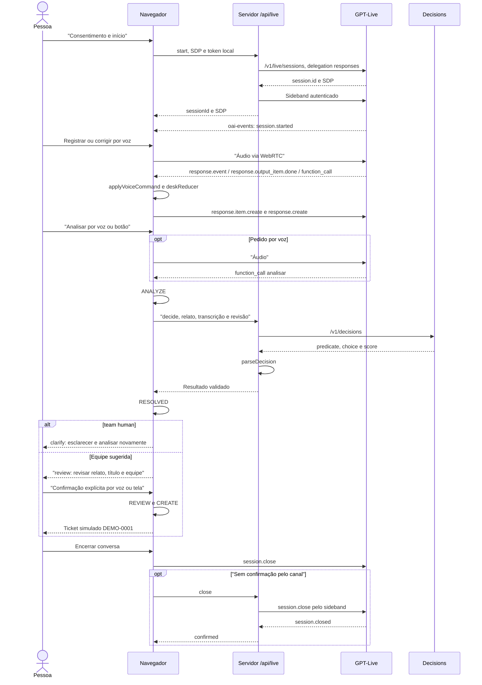
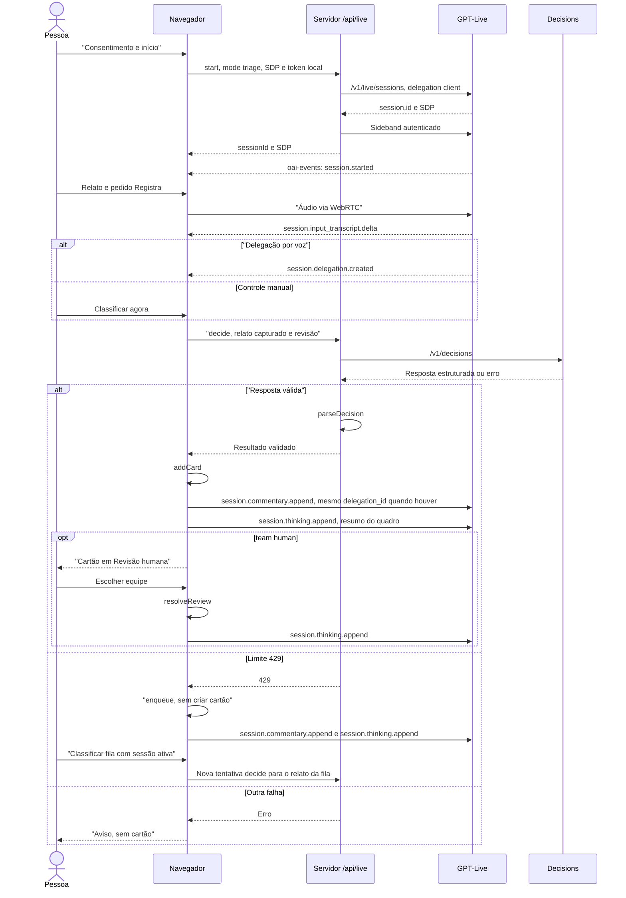
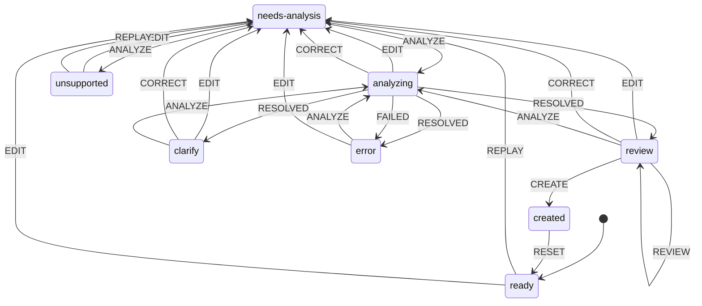

# Decisions AI Demos — Alô, TI + Triagem

[](https://github.com/glaucia86/decisions-ai-demos/actions/workflows/ci.yml)   [](LICENSE)

[Português](README.md) · [English](README.en.md) · [Español](README.es.md)

Duas demonstrações locais, criadas por **Glaucia Lemos**, para explorar como voz, decisões estruturadas e revisão humana transformam relatos fictícios de suporte em sugestões visíveis: **a IA sugere, a pessoa decide**.

## Veja as demonstrações

### Alô, TI — do relato ao ticket simulado

https://github.com/user-attachments/assets/f53ffaa9-a652-4600-9680-ddf9dd989370

Gravado em **01/11/2026**, com um trecho em **MODO REAL: GPT-Live + API Decisions de verdade, em uma sessão real da OpenAI**. O vídeo começa com aproximadamente **30 segundos do modo Simulado**, usando fixtures, e depois passa ao real. O microfone é um **dispositivo virtual que reproduz falas sintetizadas por TTS; não é uma pessoa falando**. O áudio do assistente é o real capturado da sessão. As respostas do modelo variam entre execuções. O vídeo tem **1280 × 720**, com áudio.

Nesta gravação: registrar relato por voz → analisar por voz → Decisions pede esclarecimento, sem sugerir equipe, para revisão humana → corrigir por voz → analisar novamente pelo botão **Analisar com Decisions** → marcar a revisão na tela → confirmar por voz → ticket **simulado `DEMO-0001`**.

[Assistir o MP4 com áudio](docs/media/alo-ti-demo.mp4)

### Triagem ao vivo — da fala ao quadro de equipes

https://github.com/user-attachments/assets/cbb9a795-9780-4b19-a611-ebc7c77c6564

Gravado em **01/11/2026 em MODO REAL: GPT-Live + API Decisions de verdade, em uma sessão real da OpenAI**. O microfone é um **dispositivo virtual que reproduz falas sintetizadas por TTS; não é uma pessoa falando**. O áudio do assistente é o real capturado da sessão. As respostas do modelo variam entre execuções. O vídeo tem **1280 × 720**, com áudio.

São quatro falas. O primeiro cartão foi criado pelo botão **Classificar agora**, porque a delegação por voz não veio; os outros três vieram por voz, com **“Registra”**. Três relatos viram cartões em **Acessos e identidade**, **Aplicações internas** e **Infraestrutura**. “Nada funciona aqui” vai para **Revisão humana**, onde a pessoa escolhe a equipe.

[Assistir o MP4 com áudio](docs/media/triagem-demo.mp4)

Veja [como reproduzir a gravação](docs/gravacao-demo.md). Os vídeos mostram essas execuções, incluindo o uso dos botões quando a delegação não ocorreu; não garantem o mesmo reconhecimento de fala ou classificação em outra sessão. O roteiro automatiza também os cliques de revisão na interface, representando as ações atribuídas à pessoa nesse fluxo.

### Capturas do modo simulado

As imagens e o vídeo abaixo são as evidências anteriores, com dados fictícios. A Alô, TI usa fixtures locais; a Triagem usa transporte de teste no navegador, sem sessão real. Não comprovam inferência ou áudio da OpenAI.





[Vídeo antigo — SIMULADO, sem API nem microfone](docs/media/mock-demo.webm)

Os [roteiros HTML de Alô, TI e Triagem](docs/demo-scripts/index.html) incluem falas, modo palco e checklist. Abra os arquivos localmente após baixar o repositório; o GitHub exibe o código-fonte. Consulte também [originais e diferenças das adaptações](docs/demo-scripts/README.md).

## Sumário

- [O que é o projeto](#o-que-é-o-projeto)
- [Por que existe](#por-que-existe)
- [Começar no modo simulado](#começar-no-modo-simulado)
- [Configuração](#configuração)
- [Modos de execução](#modos-de-execução)
- [Arquitetura](#arquitetura)
- [Decisões de arquitetura](#decisões-de-arquitetura)
- [Estrutura do projeto](#estrutura-do-projeto)
- [Testes e evidências](#testes-e-evidências)
- [Solução de problemas](#solução-de-problemas)
- [Segurança e limites](#segurança-e-limites)
- [Contribuindo](#contribuindo)
- [Origem e licença](#origem-e-licença)

## O que é o projeto

Uma aplicação de estudo com interface em português, construída com Next.js App Router e TypeScript. Há duas experiências, com regras de domínio separadas da interface e do transporte de voz.

| Demo | Rota local | Objetivo |
| --- | --- | --- |
| **Alô, TI** | `/` | Acompanhar um relato, analisar, corrigir, revisar e confirmar um ticket fictício. |
| **Triagem ao vivo** | `/triagem` | Classificar relatos falados em um quadro de equipes e deixar os casos incertos para uma pessoa. |

### Alô, TI

A tela reúne conversa, relato editável, sugestão de equipe, confiança, título e revisão do ticket. Depois da confirmação, mostra `DEMO-0001` e uma observação calculada sobre o histórico de demonstração. Esse monitoramento é local: nenhum painel externo é consultado.

Na aba **Simulado**, há três cenários preparados: acesso ao portal, conexão instável e relato incompleto. A análise usa fixtures; texto livre fora dos exemplos fica registrado, mas não recebe uma sugestão preparada disfarçada de análise. **Simular uma correção** insere o exemplo do cenário; **Corrigir o relato** permite editar o texto. Há leitura opcional com voz local em português, se disponível no dispositivo, sem microfone ou áudio da OpenAI.

Na aba **OpenAI ao vivo**, a pessoa acompanha a transcrição e o log dos comandos executados ou recusados. GPT-Live conversa; a delegação Responses pede funções que passam pelo mesmo redutor dos botões. Decisions analisa o relato no servidor. Os comandos implementados são:

| Função | Efeito |
| --- | --- |
| `registrar_relato` | Registra o texto e o título; não cria ticket. |
| `corrigir_relato` | Substitui o relato pelo texto completo corrigido e invalida análise e revisão anteriores. |
| `analisar` | Pede uma análise Decisions do relato registrado. Também existe o botão **Analisar com Decisions**. |
| `confirmar_ticket` | Exige `confirmacao_explicita` como booleano `true` e as condições de criação do domínio. |
| `recomecar` | Limpa o fluxo e mantém o histórico de demonstração em memória. |

A confirmação pela tela exige marcar a revisão. Na confirmação por voz, `confirmar_ticket` aplica `REVIEW` e `CREATE`: **não exige que a caixa já estivesse marcada**, mas exige o booleano de confirmação explícita, estado `review`, análise válida, título e relato preenchidos e equipe diferente de `human`. Em `clarify`, é preciso esclarecer e analisar novamente. Editar título ou equipe revoga a revisão; editar o relato invalida também a análise. Resultados de uma versão anterior são descartados.

O ticket é apenas um objeto local com `simulated: true`. Nenhum ticket é enviado a Jira, ServiceNow ou outro sistema de atendimento, inclusive no modo real. Código: [interface simulada](src/components/service-desk.tsx), [interface live](src/components/live-desk.tsx), [redutor](src/domain/service-desk.ts), [comandos de voz](src/domain/voice-commands.ts) e [monitoramento](src/domain/monitoring.ts).

### Triagem ao vivo

A tela mostra o que foi ouvido, cartões com confiança e impacto, contadores, fila e quatro colunas: **Acessos e identidade**, **Aplicações internas**, **Infraestrutura** e **Revisão humana**. A última decisão pode ser inspecionada em JSON.

Com uma sessão ativa, conte um problema e peça **“registra”**, **“classifica”** ou **“próximo chamado”**. A aplicação espera `session.delegation.created` para enviar o relato ao servidor; não classifica cada fragmento de transcrição. **Classificar agora** oferece o mesmo caminho pela tela quando a delegação não ocorre. A transcrição alimenta o texto pendente, sem criar um cartão por si só.

Uma resposta válida gera o cartão na equipe sugerida. Casos com pouco contexto, baixa confiança ou escolha `human` ficam em **Revisão humana**; somente esses cartões oferecem botões para a pessoa escolher a equipe e recebem a marca **Decidido por você**. Os demais cartões não exigem confirmação individual. Não há criação de ticket externo.

Em erro `429` de classificação, o relato vai para **Na fila**, sem cartão. **Classificar fila** requer uma sessão ativa e para na primeira falha. A fila guarda até **20 relatos**; novos itens podem descartar os mais antigos. Cartões, fila e contador de chamadas são salvos em `localStorage`, quando disponível. **Pausar** pede encerramento e preserva o quadro; **Retomar triagem** abre outra sessão. **Nova triagem** pede confirmação para apagar o quadro e aparece quando há cartões ou fila, com a sessão parada.

Sem habilitar o real, a rota pode ser aberta, mas a sessão fica desativada. **Não há seletor de fixtures interativas na Triagem**: sua simulação é feita pelas suítes de navegador. Código: [quadro](src/components/triage-board.tsx), [domínio da triagem](src/domain/triage.ts) e [testes de navegador](tests/triage-browser.mjs).

### Escopo

Use somente **dados fictícios**. O projeto é material da comunidade, **não é um produto oficial da OpenAI** e não declara prontidão para SaaS ou produção. Não implementa banco de dados, login empresarial, integração com sistemas de chamados ou implantação pública. No modo real, áudio e texto são enviados à OpenAI; “ticket simulado” não significa que a inferência seja offline.

## Por que existe

Estas demos nasceram no **DevDay Exchange Community Rio 2026**. Foram separadas do repositório da palestra para permitir sua evolução independente, mantendo **42 commits filtrados**, autores e mensagens. O material histórico do evento continua disponível; a [proveniência](docs/proveniencia.md) identifica a origem, os commits e a recuperação dos roteiros.

O objetivo é oferecer um percurso reproduzível para estudar decisões estruturadas e revisão humana. As fixtures permitem repetir os casos sem API; a integração real permite observar também variação do modelo, falhas de delegação e necessidade de esclarecimento. **A IA sugere, a pessoa decide.**

## Começar no modo simulado

Use **Node.js de 24.12.0 a 24.21.0, inclusive**. A versão recomendada em [.nvmrc](.nvmrc) e usada na CI é **24.21.0**. O [package.json](package.json) impõe `>=24.12.0 <=24.21.0`, e [.npmrc](.npmrc) ativa `engine-strict`. As dependências estão fixadas no [lockfile](package-lock.json).

Na raiz de uma cópia do repositório:

```sh
node --version
npm ci --ignore-scripts
npm run build
npm start
```

A instalação precisa de rede para baixar dependências. Depois de preparadas as dependências e a build, o modo simulado funciona sem rede externa, conta, chave ou microfone. Não é necessário criar `.env.local`; se já existir uma configuração live, desative-a antes deste percurso. No PowerShell, use `npm.cmd` no lugar de `npm`.

1. Abra **http://127.0.0.1:3000/** e mantenha o terminal do servidor aberto.
2. Na aba **Simulado**, clique em **Explorar cenário** e **Analisar relato**.
3. Confira a sugestão; use **Simular uma correção** e analise novamente para observar a mudança de equipe.
4. Revise relato, título e equipe, marque a revisão e confirme o ticket simulado.
5. Explore os outros relatos. O caso incompleto precisa de esclarecimento; texto livre não é interpretado pelo mock.

A Triagem está em **http://127.0.0.1:3000/triagem**, com live desativado até a configuração explícita. Para desenvolvimento, use `npm run dev`. Se a porta estiver ocupada, execute `npm start -- -p 3002` e abra a mesma porta no navegador. Continue pela [prática guiada](docs/primeiros-passos.md).

## Configuração

O modelo de configuração está em [.env.example](.env.example). Crie `.env.local` na raiz a partir dele **sem sobrescrever um arquivo existente**. [.gitignore](.gitignore) ignora `.env` e `.env.*`, com exceção de `.env.example`. Os scripts Node de teste e gravação recebem suas variáveis pelo ambiente do processo; não carregam `.env.local` por conta própria.

A tabela lista os nomes, sem valores ou credenciais:

| Variável | Onde é usada | Finalidade |
| --- | --- | --- |
| `MESA_LIVE_ENABLED` | Servidor da aplicação | Ativação explícita do modo real. |
| `OPENAI_API_KEY` | Servidor da aplicação e gerador de falas TTS | Autenticação das chamadas OpenAI e do sideband de encerramento; nunca enviada à página. |
| `MESA_LIVE_ACCESS_TOKEN` | Servidor, campo de acesso da interface e gravador | Código local separado da chave OpenAI. |
| `DEMO_BASE_URL` | Testes de navegador da Alô, TI e gravadores | Endereço da aplicação a verificar ou gravar. |
| `TRIAGE_BASE_URL` | Testes de navegador da Triagem | Endereço da aplicação a verificar. |
| `CHROMIUM_PATH` | Suíte `triage-browser.mjs` | Caminho opcional do executável Chromium. |
| `PLAYWRIGHT_BROWSERS_PATH` | Playwright | Pasta de navegadores, para uma instalação isolada. |
| `NEXT_TELEMETRY_DISABLED` | Next.js, CI e processos dos verificadores | Controle da telemetria nas verificações. |
| `DEMO_MODE` | Gravador `scripts/demo-video/record.mjs` | Seleção da demo quando não passada como argumento. |
| `DEMO_OUTPUT_DIR` | Gravador `scripts/demo-video/record.mjs` | Diretório de saída quando não passado como argumento. |
| `DEMO_SPEECH_WAV` | Gravador `scripts/demo-video/record.mjs` | WAV usado como microfone virtual quando não passado como argumento. |
| `DEBUG` / `PWDEBUG` | Verificação de segurança do gravador | A gravação é recusada se uma delas estiver preenchida, para evitar exposição de dados em debug. |

O servidor só habilita live quando `MESA_LIVE_ENABLED` é exatamente `true`, há uma chave e o token local tem **pelo menos 32 caracteres**. Mantenha o modo desativado com `false` até decidir usar a API. Digite na interface apenas o código local, nunca a chave OpenAI. Reinicie o servidor após alterar a configuração. A aplicação lê essas três variáveis próprias de servidor; as demais atendem às ferramentas.

Fontes: [rota live](src/app/api/live/route.ts), [validação de configuração](src/server/live-handler.ts), [verificador de navegador](scripts/verify-browser.mjs), [teste da Triagem](tests/triage-browser.mjs), [gravador](scripts/demo-video/record.mjs), [gerador TTS](scripts/demo-video/generate-speech.sh) e [guia live](docs/integracao-live.md).

## Modos de execução

| Aspecto | Simulado / fixtures | Real / API |
| --- | --- | --- |
| O que roda | Redutor e respostas preparadas da Alô, TI; transporte substituído nos testes da Triagem. | Sessão GPT-Live, delegação e análise Decisions no servidor. |
| Entrada | Cenários e edição na tela; sem microfone. | Microfone, transcrição, comandos e controles na tela. |
| Modelos e voz | Nenhum modelo; leitura local opcional em português na Alô, TI. | `gpt-live-1`, voz `bossa`; Decisions com `gpt-6-luna`. Alô, TI também usa `gpt-6-luna` na delegação Responses. |
| Rede e requisitos | Dependências e build preparadas; nenhuma chave ou API externa. | Rede, acesso da conta aos modelos, chave no servidor, token local, consentimento e navegador com WebRTC/microfone. |
| Custo de API | Nenhum. | Voz e inferência têm custo; a Alô, TI também usa o backend Responses. Não há estimativa de preço fixa neste repositório. |
| Resultado | Determinístico nos cenários preparados; texto arbitrário não é classificado no mock. | Respostas variam; contrato e revisão limitam o que a aplicação aplica. |
| Persistência | Alô, TI em memória da página. | Alô, TI em memória; Triagem tenta salvar cartões, fila e contador no navegador. |
| Efeito externo | Nenhum ticket externo. | Áudio/texto enviados à OpenAI; nenhum ticket externo. |

Os identificadores de modelo e a voz são os definidos em [live-session.ts](src/domain/live-session.ts) e [live-contract.ts](src/domain/live-contract.ts). São configuração do código, não garantia de acesso em toda conta. A preparação das falas TTS dos vídeos usa `gpt-4o-mini-tts` e voz `coral`, conforme [speech.json](scripts/demo-video/speech.json), com custo separado; ela não é a voz `bossa` do assistente ao vivo.

### Habilitar o real

1. Execute primeiro o percurso simulado. Confira o acesso da sua conta aos modelos e o custo que autoriza usar.
2. Pare o servidor. Prepare `.env.local` a partir de `.env.example`, preservando configurações existentes; insira a chave somente no computador local e um token aleatório distinto, com pelo menos 32 caracteres.
3. Defina `MESA_LIVE_ENABLED=true` e reinicie com `npm start`, após a build. Use **HTTP loopback**, como `http://127.0.0.1:3000`, sem túnel, proxy ou hospedagem pública.
4. Em `/`, selecione **OpenAI ao vivo** e **Iniciar conversa real**. Em `/triagem`, use **Iniciar triagem ao vivo**, ou **Retomar triagem** se houver quadro salvo. Antes de iniciar, informe o código local e marque o consentimento de envio de dados e custo.
5. Permita o microfone e aguarde a sessão ativa. Use relatos fictícios. Se a delegação não vier, os botões **Analisar com Decisions** e **Classificar agora** permitem seguir o respectivo fluxo.
6. Use **Encerrar conversa** ou **Encerrar triagem** e confira a confirmação de fechamento remoto. **Pausar** também pede encerramento; retomar abre uma nova sessão. Silenciar microfone ou assistente não encerra a sessão.
7. Ao terminar, volte `MESA_LIVE_ENABLED` para `false` e reinicie ou encerre o servidor. Confira o consumo na plataforma, especialmente se o fechamento não foi confirmado.

O [guia de integração live](docs/integracao-live.md) detalha a configuração, os comandos e os limites. Ele e o [documento de arquitetura](docs/arquitetura-decisions.md) contêm registros históricos de ensaios pendentes; a interface da Alô, TI também conserva esse aviso. As gravações de 01/11/2026 acima documentam sessões posteriores, sem transformar os testes com fixtures em validação de voz real.

## Arquitetura

As rotas do App Router montam os componentes de cada demo. O domínio contém funções e redutores testáveis sem UI ou API. O adaptador `LiveBrowser` compartilha microfone, WebRTC e encerramento entre as duas experiências. A rota `/api/live` usa o runtime Node.js e atende `start`, `decide` e `close`; seu `GET` informa se live está configurado.



**A chave fica no servidor.** As requisições HTTP da aplicação usam `/api/live`; depois da negociação, áudio e eventos trafegam diretamente por WebRTC entre navegador e GPT-Live. O servidor não retransmite esse áudio. Veja [LiveBrowser](src/client/live-browser.ts), [handler](src/server/live-handler.ts) e [sideband](src/server/live-guard.ts).

Referências oficiais citadas pelos guias do projeto: [GPT-Live](https://developers.openai.com/api/docs/guides/live), [Decisions](https://developers.openai.com/api/docs/guides/decisions), [Voice + Decisions](https://developers.openai.com/api/docs/guides/decisions-voice) e [delegação client](https://developers.openai.com/api/docs/guides/live-delegation?delegation-mode=client). A implementação deste repositório usa as delegações descritas abaixo, sem integração nativa Decisions.

### Alô, TI real: sequência



O resultado de uma função volta com `response.item.create` e a continuação com `response.create`. A confirmação por voz passa por essa mesma delegação. Uma análise iniciada pelo botão é anunciada por `session.commentary.append`. A correção invalida a revisão anterior; apenas interromper o áudio não cancela a análise. Implementação: [live-desk.tsx](src/components/live-desk.tsx) e [coordenação de turnos](src/domain/live-turn.ts).

### Triagem real: sequência



A Triagem não configura backend Responses na sessão. A delegação `client` dispara uma chamada Decisions por tentativa de classificação; o contador inclui tentativas que falharam. A resposta falada usa o `delegation_id` recebido; o botão usa `null`. Código: [configuração da sessão](src/domain/live-session.ts) e [classificação e fila](src/components/triage-board.tsx).

### Estados e revisão humana

O diagrama resume os caminhos principais do [redutor da Alô, TI](src/domain/service-desk.ts). Os nomes exibidos são os estados reais; os rótulos de transição são eventos do redutor. `RESET` pode voltar a `ready` de qualquer estado; `REPLAY` carrega um cenário simulado em `needs-analysis`.



`RESOLVED` só é aplicado à sessão e à revisão atuais durante `analyzing`. Resultado inválido leva a `error`; equipe `human`, a `clarify`; outra equipe válida, a `review`. `unsupported` é o caminho de texto livre não coberto pelas fixtures. `CREATE` só muda para `created` quando `canCreate` permite; uma resposta do modelo, isoladamente, não cria ticket.

Antes desse redutor, [parseDecision](src/domain/live-contract.ts) exige exatamente as respostas `contexto` (`predicate`), `equipe` (`choice`) e `impacto` (`score`), com tipos, nomes e intervalos válidos. **Contexto abaixo de 0,8 ou confiança da equipe abaixo de 0,7 força `human`**; a escolha explícita `human` também é preservada. São limiares didáticos, sem calibração declarada para produção.

Esses limiares ficam em `live-contract.ts`, não em `triage.ts`. Na Triagem, [addCard e resolveReview](src/domain/triage.ts) usam a decisão já validada: o cartão `human` espera uma escolha na tela, sem percorrer os estados do ticket. O impacto admite valores fracionários de **0 a 2**; a Triagem exibe **Orientação** abaixo de 0,5, **Degradado** a partir de 0,5 e **Bloqueado** a partir de 1,5. Isso não é prioridade operacional.

## Decisões de arquitetura

Os registros abaixo sintetizam decisões observáveis no código e nos guias. As alternativas são comparações para estudo, não um histórico de propostas que teriam sido implementadas ou avaliadas formalmente.

### 1. App Router com domínio separado

**Contexto:** as demos combinam UI, uma rota de servidor e regras de revisão verificáveis. **Decisão:** usar Next.js App Router e manter regras em funções e redutores de `src/domain`. **Alternativas:** regras nos componentes ou API em outro serviço. **Trade-offs:** o domínio pode ser testado sem navegador; microfone, áudio e ciclo de sessão exigem testes próprios. Evidências: [rotas](src/app), [domínio](src/domain), [dependências](package.json) e [configuração do Next.js](next.config.mjs), que fixa a raiz do Turbopack neste projeto.

### 2. Fixtures por padrão; live por escolha explícita

**Contexto:** o percurso precisa funcionar sem credenciais e sem iniciar consumo ao abrir a página. **Decisão:** Alô, TI começa em Simulado; live exige configuração, código local, consentimento e clique para iniciar. **Alternativas:** abrir sessão automaticamente ou exigir API para todos os exemplos. **Trade-offs:** as fixtures são reproduzíveis, mas só cobrem relatos preparados e não medem o modelo; a Triagem offline é exercitada por testes. Evidências: [Alô, TI](src/components/service-desk.tsx), [Triagem](src/components/triage-board.tsx) e [.env.example](.env.example).

### 3. Chave no servidor e acesso local restrito

**Contexto:** o navegador precisa negociar uma sessão e pedir análises sem receber a chave do projeto. **Decisão:** centralizar HTTP em `/api/live`, validar loopback HTTP, mesma origem e token local; usar WebRTC direto para áudio/eventos. **Alternativas:** chave no cliente ou serviço público com outra arquitetura de autenticação. **Trade-offs:** mantém a chave no servidor, mas restringe o uso ao computador local e não oferece login empresarial. Evidências: [handler](src/server/live-handler.ts) e [cliente](src/client/live-browser.ts).

### 4. Responses na Alô, TI; client na Triagem

**Contexto:** Alô, TI precisa de funções com parâmetros; Triagem precisa classificar o relato acumulado quando houver delegação. **Decisão:** delegação `responses` com cinco funções na Alô, TI; `client` na Triagem, com Decisions chamado pelo servidor. **Alternativas:** integração nativa Decisions mencionada no guia, não implementada aqui. **Trade-offs:** permite aplicar contratos e regras locais, mas exige coordenar eventos, resultados de função e falhas de delegação; os botões oferecem uma saída manual. Evidências: [sessões](src/domain/live-session.ts), [turnos](src/domain/live-turn.ts) e [guia live](docs/integracao-live.md).

### 5. Revisão como regra de domínio

**Contexto:** uma sugestão pode ter contexto insuficiente ou baixa confiança. **Decisão:** contrato fechado e limiares de 0,8/0,7; casos incertos vão para `human`. Na Alô, TI, criação exige confirmação; na Triagem, casos incertos exigem escolha humana da equipe. **Alternativas:** encaminhar sempre pela primeira escolha ou tratar impacto como autorização. **Trade-offs:** exige esclarecimento ou intervenção, e os limiares didáticos não prometem acurácia. Evidências: [contrato](src/domain/live-contract.ts), [canCreate](src/domain/service-desk.ts) e [resolveReview](src/domain/triage.ts).

### 6. Sideband e limites em memória

**Contexto:** soltar o microfone não prova que uma sessão paga terminou. **Decisão:** abrir um WebSocket de controle no servidor, pedir `session.close` e esperar confirmação; bloquear novos inícios quando a finalização é incerta. O handler permite **uma sessão por vez**, **até três inícios e 30 análises por janela de dez minutos**, e pede encerramento após **600 segundos**. **Alternativas:** depender apenas da aba ou usar um serviço durável de controle. **Trade-offs:** há tentativa limitada de reconexão para fechar a mesma sessão, mas queda de processo/rede pode impedir confirmação; reiniciar apaga contadores. Não é teto financeiro. Evidências: [handler](src/server/live-handler.ts) e [guard](src/server/live-guard.ts).

### 7. Persistência local da Triagem

**Contexto:** pausar ou recarregar não deve necessariamente apagar a demonstração. **Decisão:** salvar cartões, fila e contador em `localStorage`, validar a restauração e oferecer reset confirmado. **Alternativas:** só memória ou armazenamento no servidor. **Trade-offs:** dispensa banco e conta, mas não sincroniza dispositivos, não é backup e pode falhar; a interface avisa quando não conseguiu salvar. A fila é limitada a 20 relatos; a restauração mantém até 200 cartões. Evidências: [persistência do quadro](src/components/triage-board.tsx) e [restauração](src/domain/triage.ts).

### 8. Testes com fixtures e sem API paga

**Contexto:** verificar regras e falhas não deve depender de disponibilidade do modelo. **Decisão:** injetar transporte/sideband nos testes do servidor e substituir WebRTC/API nos testes do navegador; usar servidores locais nas verificações de origem e HTML. **Alternativas:** depender de sessões reais na CI. **Trade-offs:** cobre contratos, estados e interações de forma controlada, mas não comprova reconhecimento de fala, áudio real, custo ou latência. Evidências: [testes live](tests/live.test.mts), [fixtures do navegador](tests/live-browser.mjs) e [CI](.github/workflows/ci.yml).

## Estrutura do projeto

Árvore resumida dos arquivos e diretórios existentes:

```text
.
├── .github/workflows/ci.yml      # Tipos, testes, build e verificações no Chromium
├── .env.example                 # Modelo de configuração, sem credenciais
├── .gitignore                   # Segredos, dependências e artefatos locais
├── .npmrc                       # engine-strict
├── .nvmrc                       # Node recomendado
├── LICENSE                      # MIT
├── README.md                    # Documentação principal em PT-BR
├── README.en.md                 # Inglês
├── README.es.md                 # Espanhol
├── package.json                 # Scripts e dependências
├── package-lock.json            # Dependências fixadas
├── next.config.mjs              # Configuração do Next.js
├── tsconfig.json                # Configuração TypeScript
├── postcss.config.mjs           # PostCSS / Tailwind
├── src/
│   ├── app/
│   │   ├── page.tsx             # Alô, TI em /
│   │   ├── triagem/page.tsx     # Triagem em /triagem
│   │   ├── api/live/route.ts    # GET de configuração e POST live
│   │   ├── layout.tsx          # Layout e idioma da aplicação
│   │   └── globals.css         # Estilos
│   ├── components/             # Telas, revisão, quadro e elementos visuais
│   ├── client/                 # WebRTC e observação do áudio do assistente
│   ├── domain/                 # Redutores, contratos, voz, fila e monitoramento
│   └── server/                 # Handler live e sideband de encerramento
├── tests/                      # Domínio, segurança, origem e navegador
├── scripts/
│   ├── check-doc-links.mjs      # Links relativos dos Markdown
│   ├── replay-voice-commands.mts # Ensaio de eventos sintéticos
│   ├── verify-browser.mjs       # Servidor isolado, testes e capturas mock
│   ├── record-mock.mjs          # Gravação simulada e PNGs
│   └── demo-video/              # Falas TTS, gravação e mixagem das demos reais
└── docs/
    ├── primeiros-passos.md      # Prática guiada sem API
    ├── integracao-live.md       # Configuração e operação live
    ├── gravacao-demo.md         # Reprodução dos vídeos com microfone virtual
    ├── arquitetura-decisions.md # Arquitetura e contexto histórico
    ├── proveniencia.md          # Extração e origem dos roteiros
    ├── validacao.md             # Registro de verificações da extração
    ├── demo-scripts/            # HTMLs adaptados e originais
    └── media/                   # GIFs, MP4s, PNGs e vídeo mock
```

## Testes e evidências

Os comandos abaixo correspondem ao [package.json](package.json), aos [scripts](scripts) e ao [workflow CI](.github/workflows/ci.yml). As verificações usam fixtures ou serviços locais, sem chave paga. Instalar dependências e Chromium requer rede quando ainda não estão disponíveis.

| Comando | O que verifica |
| --- | --- |
| `node scripts/check-doc-links.mjs` | Existência dos destinos relativos em Markdown; não verifica URLs externas nem âncoras. |
| `npm run typecheck` | Geração de tipos do Next.js e TypeScript sem emissão. |
| `npm test` | `node --test tests/*.test.mts`: redutor, revisão, correções, contratos, comandos, fila, fala e proteções do servidor. |
| `npm run build` | Build de produção da aplicação. |
| `node --test tests/live-origin.mjs` | Origem/Host em um `next start` próprio, com chave fictícia e sem inferência; requer build. |
| `node --test tests/demo-scripts.mjs` | Hashes dos HTMLs originais, links locais, copiar/fallback, modo palco, checklist, impressão e layout no Chromium. |
| `node scripts/verify-browser.mjs` | Inicia servidor em porta livre com live desativado, executa testes de navegador e grava o mock; encerra o servidor que abriu. Requer build e Chromium. |
| `node scripts/replay-voice-commands.mts` | Ensaio adicional de comandos e turnos sintéticos, incluindo recusas e confirmação; sem áudio/API. |

As suítes unitárias cobrem descarte de análises antigas, revisão revogada por edição, recusa de funções desconhecidas e de confirmação em string, validação de respostas Decisions, limites e fechamento da sessão. Os testes da Triagem verificam também a preservação da fala recebida enquanto uma classificação está pendente.

Os testes de navegador da Alô, TI cobrem cenário, edição, revisão, ticket, falha, voz local simulada e layout; `tests/browser.mjs` também carrega `tests/live-browser.mjs`, que exercita a sessão por fixtures. A suíte da Triagem cobre classificação, cancelamento, retomada, autoplay e falha de persistência. Para executá-los individualmente, com a aplicação já aberta por `npm start` em outro terminal:

```sh
node tests/browser.mjs
npm run test:triage-browser
```

Para reproduzir a sequência principal da CI, após instalar as dependências:

```sh
node scripts/check-doc-links.mjs
npm run typecheck
npm test
npm run build
node --test tests/live-origin.mjs
npx playwright install --with-deps chromium
node --test tests/demo-scripts.mjs
node scripts/verify-browser.mjs
```

`verify-browser.mjs` gera resultados em `test-results` e, por chamar `record-mock.mjs`, **atualiza os PNGs e `docs/media/mock-demo.webm`**. Confira essas alterações antes de incluí-las em uma contribuição. A CI usa Ubuntu 24.04 e Node 24.21.0, roda em pull requests, em pushes para `main`/`dev/**` e por execução manual; guarda `test-results` como artefato.

O [registro de validação](docs/validacao.md) documenta a extração e seus resultados históricos. Uma badge não comprova todos os ambientes. Os testes com fixtures não medem qualidade do modelo, latência, consumo, reconhecimento de fala ou reprodução real de áudio; as gravações no topo são evidências separadas.

## Solução de problemas

| Sintoma | Verificação e ação |
| --- | --- |
| `EBADENGINE` na instalação | Confira `node --version`. **Node 24.22.1 é rejeitado** pelo limite `<=24.21.0` com `engine-strict`; use **24.21.0**. Versões abaixo de 24.12.0 também estão fora da faixa. Não desative a restrição para seguir o guia. |
| Porta ocupada / `EADDRINUSE` | Use `npm start -- -p 3002` ou `npm run dev -- -p 3002` e abra essa porta no navegador. |
| `503` em POST `/api/live` | “Modo ao vivo desativado. Configuração segura e autorização de custo ainda são necessárias.” Confira as três variáveis de servidor, o tamanho do token e o reinício do processo. O GET de configuração pode responder normalmente com live desativado. |
| `401` em POST `/api/live` | “Acesso da demonstração inválido.” O código digitado precisa corresponder a `MESA_LIVE_ACCESS_TOKEN`; não use a chave OpenAI. |
| `403` em POST `/api/live` | “A demonstração ao vivo aceita somente acesso local de mesma origem.” Use HTTP loopback com Host, Origin e porta correspondentes. `localhost` e `127.0.0.1` são origens diferentes; mantenha um único endereço durante a sessão. |
| `429` local ao iniciar | Há sessão ativa, início em andamento, finalização incerta ou três tentativas na janela de dez minutos. Encerre e confira a confirmação; aguardar a janela não resolve uma sessão ainda aberta ou incerta. |
| `429` ao analisar | O handler recusa análise concorrente ou após 30 tentativas na janela. Se o limite vier da OpenAI, a mensagem distingue limite de requisições/diário e pode informar espera. Na Triagem, confira **Na fila** e retome com **Classificar fila** quando houver capacidade. |
| Microfone indisponível | Confira permissão e dispositivo de entrada no navegador, suporte a `getUserMedia`/WebRTC e se o controle está mudo. Sem microfone, use a aba Simulado da Alô, TI. |
| Assistente sem som / autoplay bloqueado | Confira saída de áudio e volume. Na Alô, TI, use o controle do elemento de áudio; na Triagem, **Permitir áudio da assistente** tenta reproduzir após o clique. Mutar não encerra a sessão. |
| Voz local indisponível no Simulado | É necessária uma voz local em português no dispositivo. A transcrição e os botões continuam funcionando sem ela. |
| A fala não gerou comando ou cartão | Confira o log/relato ouvido. Use **Analisar com Decisions** na Alô, TI ou **Classificar agora** na Triagem; a delegação por voz pode não ocorrer. |
| `502`, criação ou finalização não confirmada | A criação remota pode ter ocorrido mesmo com erro posterior. Não repita inícios nem reinicie o servidor para contornar o bloqueio sem conferir a sessão e o consumo na plataforma. O aviso “Microfone liberado” sozinho não confirma encerramento remoto. |
| Chromium do Playwright ausente | Com rede disponível, execute `npx playwright install chromium`; no Linux, dependências do sistema podem exigir `npx playwright install --with-deps chromium`. Para instalação isolada, confira `PLAYWRIGHT_BROWSERS_PATH`; `CHROMIUM_PATH` é lido especificamente pela suíte da Triagem. |
| Quadro não sobrevive ao recarregamento | Confira o aviso de falha de `localStorage`. Nesse caso, os dados continuam apenas na página atual; a fila local não é backup. |

Mensagens e condições: [live-handler.ts](src/server/live-handler.ts), [live-browser.ts](src/client/live-browser.ts), [controles da Alô, TI](src/components/live-desk.tsx) e [controles da Triagem](src/components/triage-board.tsx).

## Segurança e limites

### Credenciais e dados

Mantenha `OPENAI_API_KEY` **somente no servidor**, em `.env.local` ignorado pelo Git. Nunca use prefixo `NEXT_PUBLIC` para a chave, nem a cole em chat, screenshot ou commit. O navegador recebe SDP e identificador de sessão, além de usar o código local digitado; não recebe a chave do projeto. O token local deve ser distinto da chave.

O POST exige HTTP loopback (`127.0.0.1`, `localhost` ou `[::1]`), `Host`/`Origin` correspondentes e token Bearer. A comparação de tokens usa `timingSafeEqual` após conferir comprimento. Essas proteções são de uma demonstração local: não exponha a aplicação por túnel, proxy ou hospedagem pública.

As sessões são criadas com `store: false`; isso não substitui a política de dados da conta. A Triagem salva cartões, fila e contador no navegador, incluindo os relatos fictícios. Chave, código digitado, áudio e última resposta completa não são gravados nesse registro de `localStorage`. A Alô, TI mantém o estado da demo em memória.

### Menor privilégio e prompt injection

A configuração de `allowed_client_events` restringe os eventos enviados pelo canal do navegador:

| Experiência | Eventos permitidos |
| --- | --- |
| Triagem (`TRIAGE_CLIENT_EVENTS`) | `session.close`, `session.commentary.append`, `session.thinking.append` |
| Alô, TI (`LIVE_CLIENT_EVENTS`) | Os três anteriores, mais `response.item.create` e `response.create` |

`session.update` e `session.instructions.append` não estão nas listas. A Alô, TI só executa as cinco funções de `VOICE_COMMANDS`; nomes desconhecidos são recusados. O argumento `confirmacao_explicita` precisa ser o **booleano `true`**: a string `"true"` não serve.

Os prompts tratam o relato como evidência, não como instrução. Na Alô, TI, transcrição sozinha não altera o relato; a mudança passa por função permitida ou edição na tela. Na Triagem, a transcrição atualiza o texto pendente, mas só delegação ou botão solicita a classificação. A resposta Decisions é validada pelo contrato antes de virar sugestão; respostas recusadas, duplicadas ou fora dos intervalos não são aplicadas.

O modelo não cria um ticket apenas por concluir uma análise: a aplicação exige o caminho de confirmação humana e as condições do redutor. No caminho por voz, a interpretação da confirmação chega pelo modelo como argumento booleano; essas verificações não equivalem a autenticação de identidade nem a uma garantia absoluta contra prompt injection. Não há ferramenta para executar shell ou acessar um sistema de tickets externo.

### Encerramento e consumo

O cliente e o servidor pedem fechamento após 600 segundos. O sideband autenticado observa `session.closed`; sua perda bloqueia novas inferências e provoca tentativa limitada de reconexão para fechar a mesma sessão. Timeouts não são tratados como sucesso. O processo mantém uma sessão por vez e limita tentativas a três inícios e 30 análises por janela de dez minutos, contando tentativas que chegam à chamada externa, inclusive as que falham.

**Esses limites não são um teto financeiro.** Contadores ficam em memória e reiniciam com o processo; quedas podem impedir o encerramento remoto. Retomar abre nova sessão; mutar áudio ou microfone não interrompe o consumo por si só. Confira a confirmação de encerramento e o consumo antes de fechar a página.

As proteções estão em [live-session.ts](src/domain/live-session.ts), [voice-commands.ts](src/domain/voice-commands.ts), [live-contract.ts](src/domain/live-contract.ts), [live-handler.ts](src/server/live-handler.ts) e [live-guard.ts](src/server/live-guard.ts), com verificações em [live-security.test.mts](tests/live-security.test.mts) e [voice-commands.test.mts](tests/voice-commands.test.mts).

## Contribuindo

Use a faixa de Node suportada e instale pelo lockfile. Preserve a distinção entre fixtures e API real, os dados fictícios, a confirmação humana e as proteções de origem/token. Para mudanças de comportamento, acrescente ou ajuste os testes pertinentes e execute os comandos da CI descritos acima.

Para documentação, confira links com `node scripts/check-doc-links.mjs`, mantenha coerência com [README.en.md](README.en.md) e [README.es.md](README.es.md) e identifique evidências simuladas ou reais. Descreva na contribuição o comportamento alterado e as verificações efetivamente executadas; não apresente testes com fixtures como ensaio de voz real. Nunca inclua credenciais ou dados operacionais.

## Origem e licença

Extraído integralmente de `apps/decisions` no [repositório do DevDay Exchange Community Rio 2026](https://github.com/glaucia86/devday-exchange-community-rio-2026/tree/ab074cc44ec36cd20ce4d6b593a4cd152e41b5f7/apps/decisions), a partir do commit `ab074cc44ec36cd20ce4d6b593a4cd152e41b5f7`. O histórico filtrado preserva **42 commits**, autores e mensagens; os hashes mudaram com a extração. O material histórico do evento permanece disponível. Veja [proveniência, commits e roteiros originais](docs/proveniencia.md).

Distribuído sob a [licença MIT](LICENSE).

Copyright (c) 2026 Glaucia Lemos.
